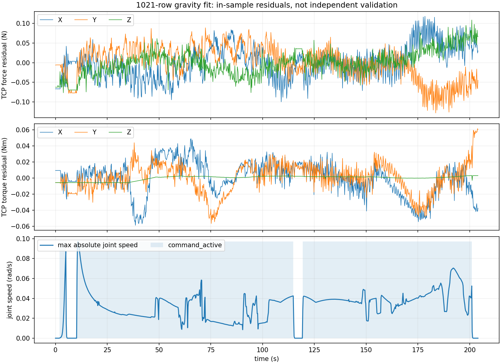

# 2026-10-13：1021 行重力负载辨识分析

本次使用用户已经生成的 `tool/ft_gravity_samples_identified.json`，并对全部原始数据独立复算。
原始 CSV 和该 JSON 已复制到本目录，避免后续采集覆盖审阅依据；未连接机械臂，也未替换用户的新标定。

## 结论

这份结果的**坐标外参正确、质量拟合稳定、数据内补偿残余小**，可以保留为当前候选标定。
它还不能视为经过独立静态验证的俯仰力矩标定：采集期间主要在运动，所有行的 `capture_id` 都是 -1，
质心参数对训练时段也较敏感。下一步优先补采少量未参与拟合的不同朝向静态数据，检查悬空残余；
若静态残余明显随姿态变化，再用完整静止窗口重新辨识。

## 数据与坐标核查

- 1021 行，约 204 秒，5 Hz；948 行 `command_active=1`，占 92.85%。该标记表示输入活动，不等价于每行都有显著运动。
- 最大关节速度的中位数 0.0360 rad/s、P95 0.0579 rad/s、最大 0.0971 rad/s。
- `capture_id=-1` 共 1021 行；阶段为 idle 999、settling 10、rejected 12，没有成功保存的静止窗口。
- 无指令且最大关节速度不超过 0.002 rad/s 的连续停顿主要为 0–1.8、5.4–10.2、115.2–119.2、201.4–204.0 秒。
  最长约 5 秒，未满足默认 10 秒采集窗口。因此本次需要使用全行模式，不能直接加 `--static-poses` 处理这份 CSV。
- 由关节值和 URDF 独立计算传感器姿态，与 CSV 的 `r_base_sensor` 最大分量差约 1.1e-11；
  在线旋转及 `[0,0,-0.195] m` 力臂通过当前加载器检查。此前约 20° 的矩阵不一致已从本次数据中消除。

## 参数如何理解

| 参数 | 结果 | 含义 |
|---|---:|---|
| 总负载质量 | 0.696574 kg | 测量端之后硬盘、夹具等负载的拟合总质量 |
| 基座中带符号重力载荷 | [-0.1793, +0.4415, -6.8144] N | 模长 6.8311 N，方向接近基座 -Z |
| 质心相对传感器 | [1.238, -6.283, 71.074] mm | 大致在传感器前方 71 mm，带少量横向偏心 |
| 质心相对插入端 TCP | [-5.317, 3.568, -123.926] mm | 负 Z 表示质心位于插入端后方约 124 mm，与 195 mm 工具长度相容 |
| 传感器力零偏 | [-7.638, -7.502, -0.943] N | 全数据联合拟合的固定偏置，并非补偿后的外力 |
| 传感器力矩零偏 | [0.749, -0.754, 0.070] N·m | 同上；需要独立姿态验证才能与重力项区分得更可靠 |

4.00° 是本次优化的上限，不能当成基座倾角测量。自由拟合为 **4.052°**，
力 RMS 为 0.038481 N；4° 约束下为 0.038492 N，几乎相同。该边界触及程度较轻，
与此前自由拟合偏好 13.8° 的历史情况不同；两次采集数据也不同，不能把改善完全归因于单一改动。

重力上限敏感性：固定竖直、2°、4°、6° 上限的力 RMS 分别约 0.08746、0.05454、0.03849、0.03848 N。
现有数据支持允许少量倾斜，但不足以区分实际安装倾斜与小的模型、偏置误差。

## 补偿残余

终端报告的 RMS 是所有行、三个分量的均方根，不是最大误差，也不是三维力模长的 RMS。

| 量 | 各轴 RMS | 三维模长 P95 | 三维模长最大值 |
|---|---|---:|---:|
| 传感器残余力 N | [0.03296, 0.04841, 0.03186] | 0.1192 | 0.1609 |
| 传感器残余力矩 N·m | [0.01980, 0.01532, 0.00289] | 0.04764 | 0.07242 |
| 插入端残余力矩 N·m | [0.02082, 0.01840, 0.00289] | 0.05489 | 0.07426 |

换算到插入端后仍小于当前 0.2 N·m 力矩死区，各轴残余力也低于当前 0.5 N 死区。
这说明在**参与拟合的这条轨迹上**，重力残余不太会直接激活导纳；不代表其他姿态或接触方向已验收。

## 稳定性与限制

将时间连续分成五块，每次拿掉一块，仅用另外四块拟合，再预测被拿掉的数据：

- 训练得到的质量为 0.69189–0.69823 kg，相对范围约 0.91%，质量较稳定。
- 保留块的力分量 RMS 为 0.02381–0.06622 N，力矩分量 RMS 为 0.00900–0.03651 N·m。
- 传感器质心 Z 为 41.3–75.8 mm。仅用前半段与后半段拟合时，分别约 69.5 与 27.5 mm；
  后半段力矩矩阵条件数升至约 235，说明该段对质心参数的约束较弱。
- 全数据力/力矩矩阵条件数约 11.2/79.2。关节虽然转过较大角度，有效重力方向变化仍集中，
  并非 1021 个彼此独立、均匀分布的静止姿态。
- 仅取低速行得到的质量约 0.7071 kg、质心 Z 约 108.5 mm；这些行来自少数短暂停顿，
  不能仅因它们速度低就认为该结果一定更准确。

这些比较说明质量的证据强于精确质心。小残差本身不能证明质心唯一；偏置、重力项和有限姿态覆盖可以互相补偿。
连续块留出验证也仍来自同一次采集，不替代下一次独立悬空验证。

## 下一步

保持目前安装，补采未参与拟合的朝向，松开 LB、让摇杆和扳机回中，每个姿态至少等到终端打印 `saved`。
先检查用当前 JSON 补偿时的悬空残余，再确认已知轴向力和抬头/低头力偶的符号。
若需要重新拟合，推荐至少 12 个朝向不同的完整窗口，并使用 `--static-poses`。
当前文件已在 Joy 默认配置所指路径，不需要再把旧矩阵手动写入 JSON。

复现：`env -u LD_LIBRARY_PATH PYTHONPATH=src .conda_envs/replace_disk_robot/bin/python logs/jaka_gravity_20261013_analysis/analyze.py`。
详细数值见 [metrics.json](metrics.json)，原始数据快照见 [input_samples.csv](input_samples.csv)。
