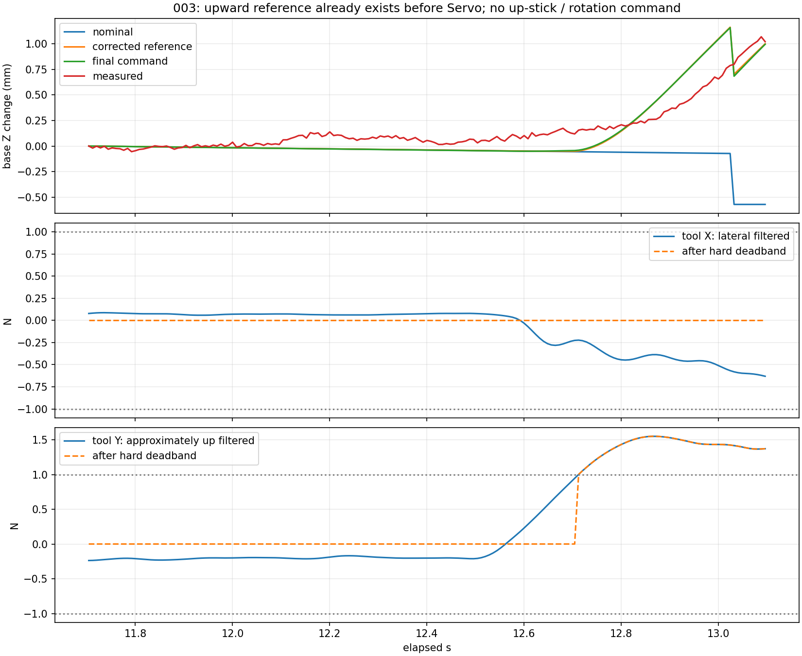
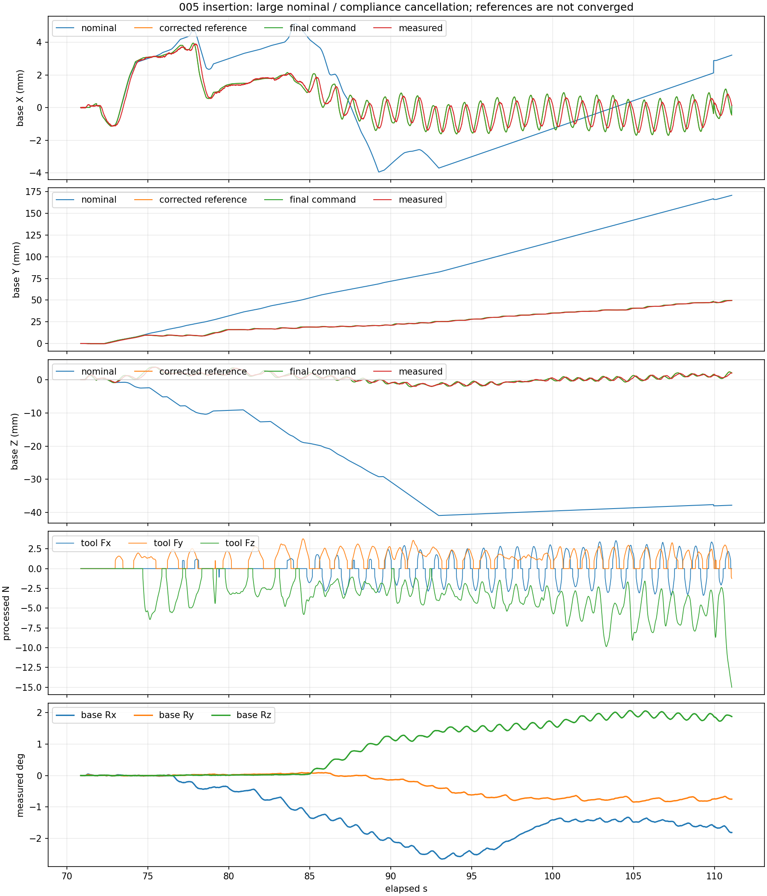

# 003–005 新日志：向上运动、残余晃动与插入 TCP 审阅

2026-10-12。仅离线读取日志、独立重算运动学并加载 MuJoCo 模型，未连接实机，未修改在线参数、标定或控制代码。

用户补充：左右按末端朝槽口看的视角；槽口几乎刚好容纳硬盘，可能两侧同时摩擦。硬盘已更换并重新做重力/零偏标定。硬盘插入端到力传感器表面约 **19.5 cm**，不是已经标定的传感器测量原点到插入端的完整三维向量。当前模型末端 link 仍沿用旧打磨工具。

文中的“实测 TCP”是由关节反馈重算的当前模型 `tool0`，并非对硬盘插入端进行独立位置测量；旧控制点与硬盘插入端之间的差异本身就是本次审阅重点。

## 结论

1. **已确认：部分向上运动是在力处理/导纳阶段生成的，Servo 下发前的目标已经向上。** 横向力被 1 N 硬死区屏蔽、竖向力越过死区的实例见下面的 003 窗口。
2. **已确认：运动学模型、力处理外参和实际硬盘控制点没有统一。** URDF/XML 对应传感器到 `tool0` 为 27 cm，日志力矩平移使用约 40 cm 且带 5 cm 横向分量，用户实测传感器表面到插入端约 19.5 cm。力旋转矩阵与模型传感器坐标还相差约 20°。这比直接继续调整 M-D-K 更需要优先核对。
3. **005 后半段的剩余晃动已出现在导纳修正参考中。** 无手柄旋转输入仍出现转动；本窗口参考到下发目标的误差仅约 0.03 mm，1 Hz 横向下发幅值基本与参考一致。接触力、错误/未核实的 TCP 和六轴导纳仍在闭环中。
4. **上移还有参考方向本身的贡献。** 005 的 94–110 s 中，名义工具 Z 轴相对模型基座水平面向上约 2.22°，扳机持续推进本身含正向基座 Z 速度。该角度不是已测得的槽口法线夹角。
5. **持续推进时参考仍未收敛。** 005 后半段内部工具 Z 导纳退让约 121 mm，工具 Y 偏移约 42 mm；大名义推进与大反向偏移互相抵消。111.064 s 最终触发 15 N 合力保护。

## 1. 数据与计算可信度

| 日志 | 时长 | 样本数 | 记录状态 |
|---|---:|---:|---|
| trial_003 | 68.944 s | 8619 | summary complete，无丢行 |
| trial_004 | 103.928 s | 12992 | summary complete，无丢行；最后一行 Ctrl-C 中断力处理，单独标记缺失阶段 |
| trial_005 | 121.248 s | 15157 | summary complete，无丢行 |

三份均记录新版 `command_trajectory_feedforward`，本次审阅时对应源码与日志快照全部一致，且使用同一份力外参和六轴导纳参数。004 的尾行不参与有效接触段力处理计算；分析没有把缺失数据补成零。

从日志 URDF 快照独立累乘关节变换重算 FK，位置差最大约 1e-15 m；根据原始力、已记录偏置、重力向量和姿态重算补偿及 TCP 换算，残差约 1e-14；重算随 TCP 移动/转动搬运的低通、硬死区、导纳积分和偏移应用，均在浮点精度内一致。这证明现有计算按记录参数执行，不证明参数代表真实硬盘安装。

005 每周期软件计算中位数约 1.61 ms，P95 约 2.03 ms，力处理约 0.48 ms、参考到 Servo 约 0.30 ms。94–110 s 下发关节与实测关节的去趋势互相关有效滞后仍约 **128–136 ms**，相关系数约 0.997–0.998。这是执行/滤波/采样综合响应，不是纯网络延迟。软件耗时与执行响应应分别理解。

## 2. 003 的向上运动来自哪里

选取 **11.704–13.096 s**：左摇杆竖向输入绝对值仅约 3e-5，低于 0.15 手柄死区；角速度命令全为零。

| 量 | 基座 Z 变化 |
|---|---:|
| 名义参考 | -0.571 mm |
| 导纳修正部分 | +1.572 mm |
| 修正后参考 | +1.000 mm |
| Servo 下发目标 | 约 +0.995 mm |
| 实测 TCP | +1.021 mm |

名义参考包括手柄参考积分和回中时重锚，并不等同于仅对手柄速度做积分。这个窗口足以确认：向上目标在进入 Servo 前就已生成。

此姿态下工具 X 基本为横向，工具 Y 基本为竖向。横向滤波力峰值仅 **0.631 N**，整个窗口被 1 N 硬死区置零；工具 Y 滤波力最高 **+1.549 N**，约 28% 周期越过死区进入导纳。向上柔顺位移主要来自工具 Y 平移偏移，而该窗口旋转导纳偏移很小。

因此，当前控制器没有得到足够的“向右净力”输入，却得到了向上输入。关闭旋转可以帮助分离力矩耦合，但不能单独修复这个平移输入问题。



## 3. URDF、XML 与力标定中的几何定义

本次直接读取 URDF 固定关节链，并加载 XML，用 `tool0` 与 `tcp_fts_site` 的世界位姿反算相对变换；两模型结果一致。

| 定义来源 | 含义 | 数值 |
|---|---|---|
| URDF `tool0_joint` / XML `tool0` | 模型传感器原点到控制点的轴向距离 | 0.27 m |
| 三份日志 `tool_to_sensor_m` | TCP 指向假定传感器测量点，工具坐标表达 | `[0, +0.05, -0.40] m` |
| 用户测量 | 传感器表面到硬盘插入端 | 约 0.195 m |

模型传感器到工具旋转约为：

```text
[-0.707, +0.707, 0]
[-0.707, -0.707, 0]
[ 0,      0,     1]
```

日志实际使用：

```text
[-0.707, +0.707,  0    ]
[-0.664, -0.664, -0.342]
[-0.242, -0.242, +0.940]
```

二者相差近似绕工具 X 的 **+20.01°**。如果真实 EDG 传感器轴与 URDF/XML 的传感器轴一致，那么把模型中的纯向后轴向反力 `[0, 0, -5] N` 经过当前额外旋转，会得到约：

```text
[0, +1.71, -4.70] N
```

这会把轴向接触反力混入正向工具 Y，且足以越过 1 N 死区，产生向上导纳。它是明确可复现的矩阵效应；**是否就是实机真实误差，仍取决于 EDG 输出轴是否与模型传感器轴同定义**。用户反馈没有明显倾斜转接结构，使这项旧外参尤其值得优先验证。不能仅凭日志宣布 20° 应无条件删除。

力臂的错误主要影响力矩与旋转导纳，不直接旋转平移力。若同轴近似下多算约 20 cm 力臂，5 N 横向力就可能多出约 1 N·m 力矩，超过当前 0.5 N·m 力矩死区。总力矩还有传感器直接测量项和横向力臂项，不能把总力矩简单按长度比例缩放。

运动学 TCP 也需要同步对准实际插入端。若真实端点与模型控制点沿轴向相差约 7.5 cm，2° 转动可造成约 2.6 mm 端点运动差。对于几乎零间隙槽口，这个尺度已经很大。这里的距离举例尚未扣除传感器表面到测量原点的偏移。

用户已重做重力标定，本报告不把问题归为“没有标定”。但当前 `identify_ft_payload.py` 拟合重力、质心及偏置，并把采集元数据中的 `rotation_sensor_to_tool`、`tool_to_sensor_m` 输出到结果中；它没有自动辨识新的安装旋转和插入 TCP。旧外参可以随重力重新标定继续保留下来。

## 4. 005 后半段为何还晃动

重点有效段取 **70.856–111.056 s**，保护后不用于接触控制归因。全段角速度手柄命令为零；期间仍有平移手动调整。

- 实际基座 Y 推进约 **49.6 mm**，名义 Y 推进约 **170.8 mm**，柔顺部分在 Y 方向改变约 **-121.2 mm**。这些是内部参考抵消，不能称为实际目标还落后 12 cm。
- 名义 Z 降低约 **37.8 mm**，柔顺部分抬高约 **39.8 mm**，实际 Z 最终升约 **2.0 mm**。这段包含竖向摇杆操作，不能把全部位移都归给力控。
- 工具 Y 导纳偏移最高约 **41.6 mm**，工具 Z 退让最高约 **120.9 mm**。旋转偏移峰值约为工具 X **2.67°**、工具 Y **2.05°**。

再取 **94–110 s**，竖向手柄也在死区内、角速度命令仍为零：

| 1 Hz 横向主频成分 | 峰峰值 |
|---|---:|
| 导纳修正参考，基座 X | 1.970 mm |
| Servo 下发目标，基座 X | 1.963 mm |
| 实测 TCP，基座 X | 1.567 mm |
| 实测绕基座 Z 旋转 | 0.187° |

参考到下发目标的位置 RMS 约 **0.030 mm**。该窗口中下发没有再次放大参考振幅，剩余晃动主要已经体现在修正参考内。此结论针对该窗口，不代表真实接触闭环已经稳定。

工具 Y 力矩的传感器直接项标准差约 **0.250 N·m**，力臂项约 **0.847 N·m**；力臂项对旋转输入有明显贡献。但二者相关，不能据标准差声称精确贡献百分比。

大偏移还有一个数学耦合：当前平移修正为 `p_corrected = p_nominal + R_measured * offset`。当 `offset` 达到约 10 cm，实测姿态轻微变化也会改变平移修正。按逐周期精确分解 `d(R*x) = R_mid*dx + dR*x_mid`，94–110 s 中由旧偏移随姿态转动产生的去趋势位移跨度约 X **0.87 mm**、Z **1.20 mm**。这不是新增物理力臂，而是当前参考生成方式的姿态耦合；它会把持续积累的参考抵消带入横向晃动。

另外，94–110 s 的名义插入轴固定为基座方向约 `[0.0688, 0.9969, 0.0387]`，相对基座水平面向上 2.22°。没有竖向摇杆输入时，推进速度本身仍含约 **+0.193 mm/s** 竖向分量。这也是后段向上运动的来源。实际槽口法线和硬盘自身轴尚未独立标定。

111.064 s 处理后合力约 **15.06 N**，触发力保护。力保护仍正常工作。



## 5. 为什么蹭左边不一定往右

单侧、近似无摩擦并且方向已核实的接触下，左侧反力通常会推动工具向右退让。但用户确认槽口极小、两侧都可能接触，此时左右反力可以部分抵消，轴向摩擦、上下边接触及姿态误差可以产生其他力和力矩。六维净力不能唯一还原所有接触位置。

现有导纳仅按传入的净力/力矩改变参考，没有“识别左侧接触然后执行向右对中”的接触状态机。横向净力被死区屏蔽时，也无法根据该信号自动决定向右。几何外参不一致又可能把轴向反力变成向上分量。

## 6. 建议处理顺序

1. **统一硬盘插入 TCP。** 以插入端中心定义独立 `insert_tcp`，测清它到传感器测量原点的三维向量和硬盘轴向。URDF、XML、实机运动学控制点及六维力换算均使用同一定义；旧打磨 `tool0` 可以保留为旧工具帧。19.5 cm 是有价值的测量，但还不能直接作为 `tool_to_sensor_z=-0.195` 的完整依据。
2. **核对传感器安装轴和约 20° 旋转。** 用已知方向的左右、上下、前后轻载只读记录确认 EDG 输出轴与模型轴关系。确认外参后再配套更新重力/偏置计算，避免只改单个矩阵造成补偿不一致。
3. **分离平移和旋转接触响应。** 使用统一几何后，先做平移导纳对照，再按矩形槽口需要逐轴开放旋转。仅关闭旋转不会消除已经进入平移导纳的向上力。
4. **约束受阻时的推进参考。** 接触后限制名义超前量、插入力和姿态修正范围，避免名义参考与导纳偏移增长到十厘米后继续互相抵消。双边夹紧时需要退让/微调姿态的策略，而不应持续顶推。

本次未用约略尺寸直接修改模型、外参或导纳增益。分析已经足以确定优先修正几何定义和受阻参考管理；最终三维插入 TCP 与传感器输出轴还需要实物定义/方向验证。

## 文件与复现

- [全部数值、源文件校验和独立计算残差](metrics.json)
- [离线复现脚本](diagnose.py)

```bash
env -u LD_LIBRARY_PATH PYTHONPATH=src .conda_envs/replace_disk_robot/bin/python logs/jaka_joy_comparison_003_005/diagnose.py
```

该脚本使用仓库已有的独立 URDF FK 辅助脚本，并读取完整日志和元数据快照；不会创建机器人客户端。
