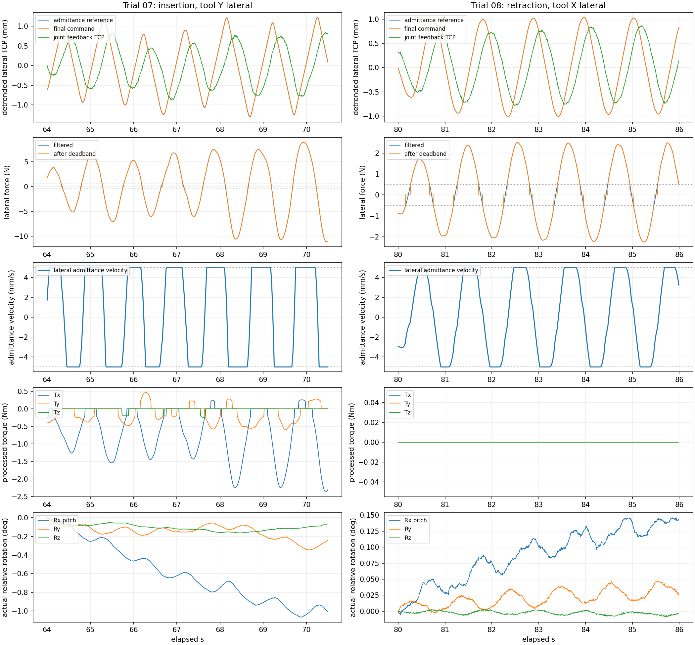

# 1013_07 / 08：成功插入后的晃动分析

仅离线读取两个包并重算运动学、重力补偿、力矩平移、滤波、死区、导纳积分和目标下发关系。
未连接机械臂、未修改在线控制参数。成功插入由用户反馈确认；日志没有槽口视觉、接触位置或“完全插入”事件，
下文按前进、回撤和接触输入划分窗口，不把 TCP 轴向位移等同于硬盘实际插入深度。

## 结论

剩余晃动主要表现为 **约 0.9–1.1 Hz 的横向导纳往复运动，叠加数度的缓慢姿态漂移**。
证据最支持“接触反力进入导纳 → 横向目标反复修正 → 关节反馈存在约 0.13–0.16 s 综合滞后 → 接触反力换向 → 再修正”的闭环往复。
横向速度频繁达到 ±5 mm/s，上下/左右接触输入也在反复换向，符合受限幅的接触闭环振荡。
这不是已经证明了某个固定环境模型的稳定性结论；摩擦、槽口双边接触和实机执行动态尚未独立辨识。

**07 的前进接触段更明显且后段接触力波动增大；08 的前进段较小，最明显的往复发生在回撤段。**
08 的 80–86 s 中，三个旋转力矩输入均为零、名义姿态固定，横向平移仍以约 0.94 Hz 摆动。
因此单独关闭旋转导纳不足以解决全部晃动。

## 1. 配置、坐标与记录质量

两个包参数相同，均使用新重力标定（质量 0.696574 kg、URDF 传感器旋转、195 mm 力臂）和
`command_trajectory_feedforward` Servo；此前 20° 软件旋转差异没有重新出现。

- 07：9682 行、77.448 s；08：12312 行、98.488 s。均 complete，无丢行、无观察器错误、无缺失力阶段。
- 所有记录的来源文件哈希与本次审阅时一致。
- 前进/回撤上限 5 mm/s；横向导纳上限也为 5 mm/s。
- Z 轴导纳关闭；X/Y 平移和三个旋转导纳仍开启。
- 平移 `M=20, D=300, K=30`；旋转 `M=2, D=15, K=2`。
- 旋转速度上限 0.005 rad/s，约 0.286°/s；角偏移总上限 10°。
- 力/力矩硬死区 0.5 N / 0.2 N·m；滤波 alpha=0.2；力保护 30 N / 5 N·m。
- 07 前段存在手柄旋转操作；下表所选接触窗口角速度指令均为零。08 全包无手柄旋转指令。

独立 FK 位置误差小于 8e-16 m；重力补偿、力/力矩变换和随 TCP 搬运的滤波最大残差约 4e-14；
导纳积分最大残差约 9e-19。没有发现这里的额外取反、不同步读取或积分公式执行错误。
循环计算中位数约 1.4–1.6 ms，未出现 loop_timeout 故障。

07 约 6.44–6.54 s、08 约 20.74–20.87 s 有力保护触发周期，之后恢复继续；
这些早期保护事件与下表后续持续摆动窗口分开分析，不把故障驻留的数百行误计为数百次新触发。

## 2. 摆动量化

以窗口起始工具轴表达位移，先去除线性前进/漂移，再在 0.4–4 Hz 内定位主频并拟合正弦。
下面是**主频成分的峰峰值**，不是全过程最大减最小，也不是单侧振幅。
短窗口、非正弦和频率变化限制了拟合精度；精确数值用于比较量级。

| 包与窗口 s | 行为 | 主轴 / 频率 | 导纳参考峰峰值 mm | 最终下发 mm | 关节反馈 TCP mm | 该轴速度限幅占比 |
|---|---|---|---:|---:|---:|---:|
| 07，30–38 | 前进接触 | 工具 Y / 1.025 Hz | 1.256 | 1.252 | 0.982 | 8.4% |
| 07，50–60 | 前进接触 | 工具 Y / 1.075 Hz | 1.726 | 1.716 | 1.216 | 50.1% |
| 07，64–70.5 | 前进接触 | 工具 Y / 1.025 Hz | 1.848 | 1.834 | 1.285 | 74.8% |
| 08，50–53.8 | 前进接触 | 工具 Y / 1.144 Hz | 0.865 | 0.848 | 0.561 | 15.2% |
| 08，76.5–80 | 回撤接触 | 工具 Y / 0.885 Hz | 2.241 | 2.205 | 1.695 | 64.5% |
| 08，80–86 | 回撤接触 | 工具 X / 0.938 Hz | 1.864 | 1.860 | 1.453 | 38.7% |

窗口工具 Y 基本指向上方，工具 X 基本为水平横向，工具 Z 为插入轴。
07 后段另一个横向轴也有约 1.09 mm 的主频峰峰值；08 80–86 s 的另一横向轴约 1.25 mm。

参考到最终下发的平移 RMS 约 0.010–0.052 mm，角度 RMS 约 0.0005°。
主频目标振幅也几乎一致，说明横向摆动已在导纳参考中形成，未见此前 Servo 计算再次显著放大目标的情况。
执行侧仍有滞后：去除线性趋势后，主要关节目标到反馈相关性峰值在约 128–160 ms；
这是执行、滤波和采样的综合估计，不能当成网络延迟。关节 6 激励弱时的低相关估计不作为主要证据。



## 3. 为什么 07 后段越来越明显

07 30–38、50–60、64–70.5 s，平均轴向反力分别约 13.29、13.47、17.35 N；
工具 Y 接触力的主频峰峰值分别约 2.79、5.92、14.34 N。
力与反馈横向位置的主频相位差接近 180°，即位置向某一侧偏移时，该侧反力增大。

相同主频下“力幅值 / 位置幅值”从约 2.84 增至 4.87、11.15 N/mm。
这是轨迹上的动态表观比值，包含摩擦和姿态耦合，不能当成单独测得的材料静态刚度。
它说明后段同样大小的横向位移对应更大的接触反力；在同一组导纳参数下，修正更容易持续顶到速度上限。

平移通道为 `20*x'' + 300*x' + 30*x = F`。
在偏移不大时，维持上限 5 mm/s 的阻尼项只需约 `300*0.005=1.5 N`，
而后段横向力多次达到数牛顿至约 10 N，足以反复把速度推向 +5 / -5 mm/s。
最终目标到实际位置又滞后约 0.14 s，在约 1 Hz 处对应约 50° 的相位差。
紧配合接触下，修正尚未完成，反力已经随着实际位置换向；这是往复难以自行消失的主要嫌疑。
限幅抑制了速度无限增加，但不保证闭环收敛。

## 4. 为什么 08 没有旋转力矩输入也会晃

08 80–86 s：操作员仅沿轴向回撤，名义横向和姿态参考没有周期运动；三个处理后力矩均为零。
工具 X/Y 接触力仍周期换向，横向导纳仍产生约 1.9 / 1.4 mm 的主频参考峰峰值。
因此该段周期运动的直接控制来源是平移导纳。

零力矩输入不等于旋转导纳状态立刻归零：之前积累的角偏移仍在弹簧项作用下缓慢回正。
该段 Rx 约从 -0.250° 回到 -0.111°，这解释了慢变化的一部分；
修正参考的 Rx 主频成分仅约 0.0018°，远小于横向往复。
反馈姿态仍有约 0.026° 的小周期变化，说明关节实际跟随并非理想刚体姿态保持；
仅由日志 FK 无法进一步分离各关节动态与真实工具弹性变形。

该段反力比 07 后段小，仍能维持摆动，也说明“成功插入、平均力较低”不足以证明横向接触闭环已经稳定。

## 5. 姿态慢漂移与长工具的视觉放大

07 主活动段的旋转导纳偏移跨度约 Rx 2.44°、Ry 4.82°；
其中 30–38 s 的 Ry 实际转动约 +2.27°，64–70.5 s 的 Rx 实际转动约 -1.01°，均无手柄角速度输入。
这些度级变化主要是接触力矩持续推动的慢修正，需与约 0.1° 量级的周期姿态摆动区别。

旋转阻尼在速度上限处只对应 `15*0.005=0.075 N·m`，小于 0.2 N·m 死区门槛；
角偏移近零时，刚越过硬死区的输入就已经高于这一阻尼项，旋转容易进入限速。
例如 07 30–38 s 的 Ry 导纳速度持续饱和，约 0.286°/s 连续数秒便积累了约 2.3° 修正。
旋转弹簧 `K=2 N·m/rad` 也较弱：0.2 N·m 对应的静态平衡角已约 5.73°；
10° 的总角偏移上限不等于紧配合插入时的小角度约束。

195 mm 工具使同样转角对应明显手腕位移。30–38 s 中，TCP 横向 X 净变化约 -3.31 mm，
传感器原点横向变化约 -11.04 mm；两者差约 7.73 mm 来自工具姿态变化的几何关系。
因此观察后方手腕时，可能感觉比插入端的毫米级周期摆动更大。

平移弹簧也允许较大慢偏移：0.5 N 的持续偏力在 K=30 N/m 下对应约 16.7 mm 静态偏移。
07 的 X 导纳偏移跨度约 20.8 mm。该控制目前缺少明确的槽口中心约束和接触后的参考状态管理。

## 6. 重力补偿与死区的作用

两个包都使用新的外参和标定。07 后段，传感器原始力的主频峰峰值约 9.84 / 10.98 / 6.66 N，
对应模型预测重力随姿态变化的主频峰峰值仅约 0.0001 / 0.0009 / 0.015 N。
不支持把这次多牛顿周期力波动主要归因于重力补偿随姿态摆动。
静态标定仍可能留下偏置并影响慢漂移，但它不是当前最有证据的周期晃动来源。

硬死区让力在 0 与门槛外原值之间跳变。07 后段 Y 通道约 6.5 秒发生 26 次开/关，
08 回撤 X 通道约 6 秒发生 22 次；它给已经存在的接触波动增加切换。
不过 07 后段多数周期远超死区，不能仅靠改死区就认定问题解决。

## 7. 后续修改优先级

1. **先针对横向接触闭环降低修正带宽。** 在含 0.13–0.16 s 执行滞后的模型中扫描阻尼与速度上限，
   然后实机逐项对照；目标是让横向修正不再长时间在 ±5 mm/s 两端翻转。
   单独提高 Servo 跟踪增益或继续增大力保护阈值没有得到本包支持。
2. **给旋转修正更明确的范围和自由度。** 保留插入所需的俯仰/偏航时，限制角偏移、角速度并重新匹配阻尼；
   绕插入轴的自由度单独验证必要性。不能把“全部锁旋转”视作横向晃动的完整修复。
3. **将硬死区改为连续过渡，并管理接触参考。** 减少门槛切换，同时避免很弱的弹簧允许厘米级平移与数度角偏移长期积累。
4. **接触后的轴向推进需要受力约束。** 当前 Z 导纳关闭，因此前进不再被同速退让抵消，但也没有恒定插入力目标。
   07 后段 17 N 左右平均阻力仍在继续前进；应把接触后的限力、停滞处理和推进速度一起设计。

现有日志能定位直接运动来源，尚不能唯一确定摩擦系数、环境刚度或一组必然稳定的参数。
短暂保持轴向输入为零、继续记录同一接触状态，可进一步区分进退摩擦诱发的摆动与保持接触时仍存在的闭环振荡。

## 文件与复现

- [metrics.json](metrics.json)：各阶段复算误差、振幅、频率、滞后、限幅比例和几何换算。
- [07 全段概览](trial07_overview.png)、[08 全段概览](trial08_overview.png)。
- [diagnose.py](diagnose.py)：读取包内模型/配置快照进行复算，模型几何对照使用当前一致的 XML。

```bash
env -u LD_LIBRARY_PATH PYTHONPATH=src .conda_envs/replace_disk_robot/bin/python \
  logs/jaka_joy_comparison_007_008/diagnose.py
```
