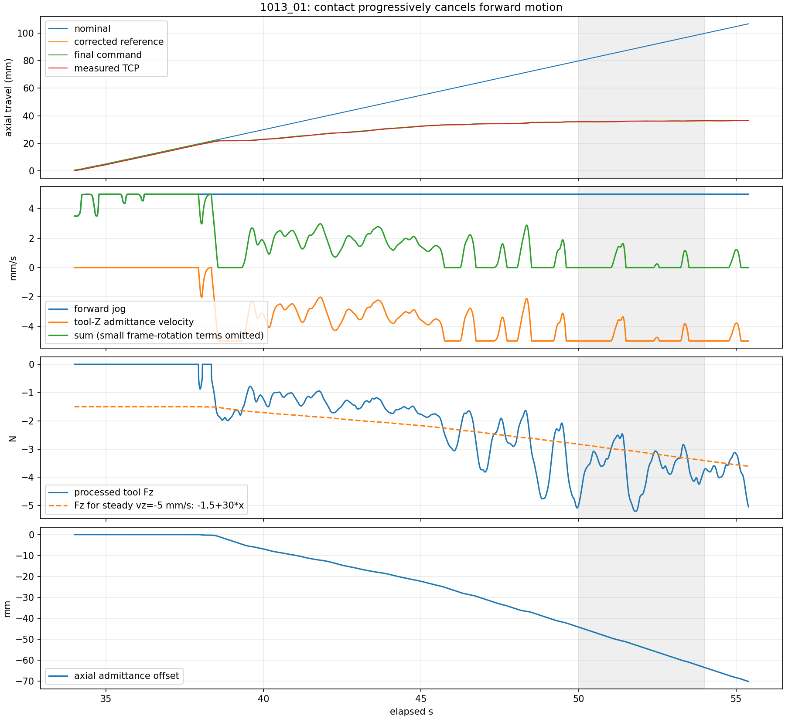
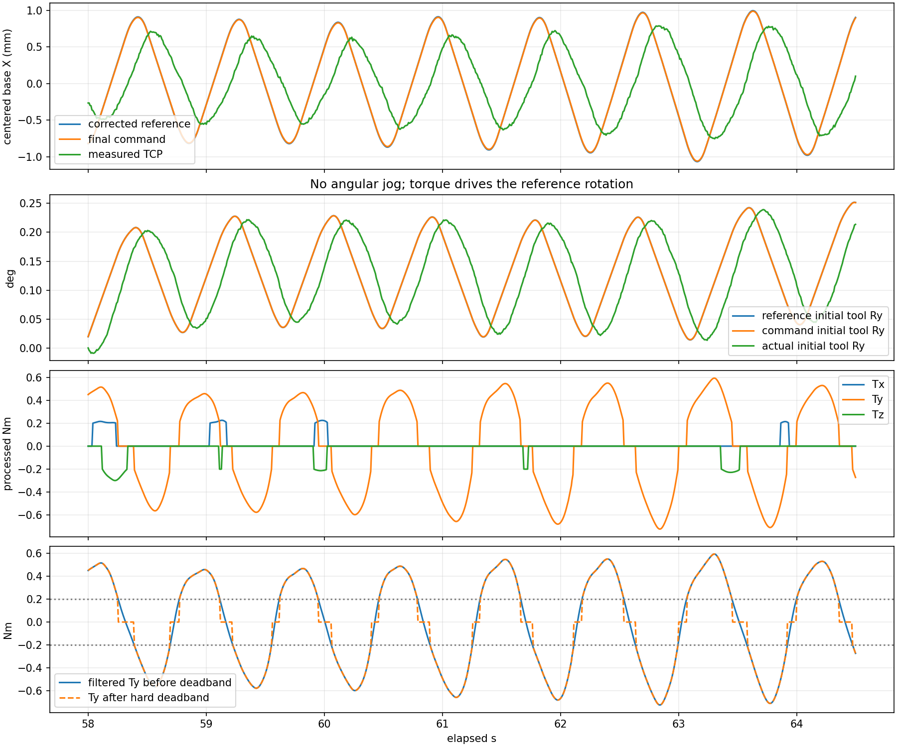

# 1013_01：前进被抵消与小幅扭动分析

2026-10-13。仅离线分析 `logs/jaka_joy_trial_1013_01`，未连接实机、未修改控制或运行参数。文中实际 TCP 为关节反馈结合当前 URDF 重算的位置；没有独立测量槽口坐标或硬盘实际插入深度。

## 结论

**轴向导纳退让几乎完全抵消前进指令，已由日志确认。** 59–62 s 中请求前进约 +5.000 mm/s，导纳工具 Z 速度约 -4.998 mm/s，最终下发的净轴向速度仅约 +0.002 mm/s。这个片段实际净推进约 0.055 mm。

**小幅转动主要在旋转导纳参考中生成。** 全程手柄角速度指令为零，但六轴导纳开启，接触力矩进入旋转通道。58–64.5 s 中约 1.15 Hz 的工具 Y 旋转主频峰峰值约 0.184°，横向位移主频峰峰值约 1.24 mm；参考到下发的角度 RMS 约 0.00043°。慢变化的姿态修正也存在，首段接触工具 Y 导纳偏移约 1.36°，工具 Z 约 0.84°。

**19.5 cm 已生效。** 当前主要停滞机制是持续速度推进与轴向柔顺退让相加、受阻参考继续积累；改变 TCP 长度本身不会改变这一控制结构。真实的双边卡紧、摩擦或姿态误差是否也阻止插入，需要结合槽口/接触状态判断，不能从软件抵消直接推断“强制前进就会成功”。

## 1. 本包实际运行配置与记录质量

日志共 13354 行、106.824 s，summary complete、无丢行、无观察器错误、无缺失力处理阶段。来源快照与本次审阅时对应文件一致。

- URDF、XML 和在线 `tool_to_sensor_m` 均对应 `[0, 0, -0.195] m`。
- 使用新版 `command_trajectory_feedforward` Servo。
- 前进速度上限 5 mm/s，轴向导纳速度上限也为 5 mm/s。
- 六轴导纳全部开启，无轴禁用。
- 平移 `M=20 kg, D=300 N·s/m, K=30 N/m`；旋转 `M=2, D=15, K=2`。
- 本包力死区 **0.5 N**、力矩死区 **0.2 N·m**，并开启 `tare_compensated`；之前 005 对应为 1 N、0.5 N·m、未开启额外去皮。因此本包与 005 的差异不只有 TCP 长度，不能当作单变量对照。
- 当前传感器旋转外参仍与模型传感器轴相差约 20°，尚未完成独立方向验证；本报告没有把该差异认定为本次速度抵消的必要原因。

独立 FK 重算误差约 7e-16 m；重算重力/偏置补偿、力矩平移、随 TCP 搬运的滤波、死区、导纳积分和偏移应用，最大残差均在浮点精度内（力处理约 4e-14，导纳约 9e-19）。没有发现这条链路的算式执行错误。

dt 中位数 7.999 ms、P95 8.080 ms、最大 10.696 ms，未见循环超时。软件每周期计算中位数约 1.63 ms。58–64.5 s 的关节目标到反馈有效滞后约 136–168 ms，多数关节约 144 ms；这是执行/滤波/采样的综合估计，不是网络延迟测量。

约 7.704 s 有一次早期力保护，随后仍有持续超阈值读数被记录，直到恢复；主插入停滞窗口取后续有效激活段，不把这段早期峰值混为主要插入力。

## 2. 抵消发生在 Servo 之前

下面速度均为沿每个窗口开始时名义工具 Z 方向投影的平均净速度。接触段工具 Z 接近基座 +Y。实际净速度描述首尾推进量，不代表期间没有侧向往复运动。

| 时间段 | 名义前进 mm/s | 柔顺修正的轴向速度 mm/s | 最终下发 mm/s | 实际净推进 mm/s |
|---|---:|---:|---:|---:|
| 34–37 s，无明显接触输入 | +4.793 | 0 | +4.793 | +4.726 |
| 50–54 s，接近停滞 | +5.000 | -4.827 | +0.173 | +0.191 |
| 59–62 s，停止后重新推进 | +5.000 | -4.997 | +0.002 | +0.018 |
| 97.7–100.4 s，再次接近停滞 | +5.000 | -4.792 | +0.210 | +0.200 |

在 59–62 s：名义参考前进约 **14.960 mm**，柔顺部分退让约 **14.951 mm**，修正参考仅前进约 **0.009 mm**，最终下发约 **0.007 mm**。抵消率约 **99.94%**。轴向导纳速度限幅在 **97.6%** 的周期触发。

这些窗口始终处于 `tracking`，没有触发力保护；修正参考到下发位置 RMS 约 0.009 mm。软件最终提供给机器人执行的前进目标已经接近停止。

严格地说参考为 `p_ref = p_nominal + R_measured*x`，因此还存在姿态转动项。将逐周期变化精确分解为 `R_mid*dx + dR*x_mid`，59–62 s 姿态转动对轴向平均速度贡献只有约 **+0.0036 mm/s**。抵消主要来自轴向导纳退让，旋转耦合对此片段平均推进速度的影响很小。



## 3. 为何几牛顿阻力就能抵消

当前轴向导纳为：

```text
20*x'' + 300*x' + 30*x = Fz
最终推进速度 ≈ 名义推进速度 + x'
```

外界阻力令 `Fz<0`，导纳就产生负向退让。名义前进为 0.005 m/s 时，若退让达到 -0.005 m/s，两者即可抵消。

在近似稳态且尚未计入偏移时，`D*v = 300*(-0.005) = -1.5 N`。因此零偏移附近约 1.5 N 的轴向反力就能对应完全抵消的退让速度。已有负向偏移时还要计入弹簧项：

```text
Fz_for_cancel ≈ -1.5 + 30*x
x = -0.05 m 时，约为 -3.0 N
```

59–62 s 偏移约从 -10.5 mm 增至 -25.4 mm，对应抵消所需反力约 -1.8 至 -2.3 N，而记录的轴向输入平均约 **-3.86 N**，足以让退让速度频繁饱和到 -5 mm/s。

当前算法没有目标插入力。它把操作员的速度不断积分为名义位置，再叠加对外力的柔顺退让。这是“受力退让”的行为，尚未包含“接触后维持合适推力并对中”的插入策略。

## 4. 停滞时名义参考仍在积累

38–55.4 s 内：

- 名义轴向参考推进约 **87.0 mm**。
- 柔顺部分轴向退让约 **70.2 mm**。
- 实际净推进约 **17.2 mm**，后半段越来越慢。

到该窗口末尾，内部轴向偏移约 -70.2 mm。修正目标仍靠近实际位置，因此不能把这 70 mm 称为机器人实际跟随误差；它表示两个内部状态持续互相抵消，没有收敛到固定接触参考。

持续静止且继续请求 5 mm/s 时，负向偏移增长还会增加弹簧项。按当前 K，抵消所需反力幅值约以 `K*v = 0.15 N/s` 增长。这种结构不是维持固定插入力。停止、重新按 LB 后偏移虽被复位，本包仍再次出现几乎完全抵消，说明复位本身没有解决接触后的控制目标问题。

## 5. 小幅扭动的来源

全包手柄角速度指令均为零，但 `admittance_axes=all`，因此手柄没有旋转输入并不等于旋转参考固定。

首段 38–55.4 s，工具 Y 旋转偏移最高约 **1.36°**，工具 Z 约 **0.84°**。这体现为缓慢姿态修正/漂移，叠加短周期小摆动。

58–64.5 s 稳定接触段，横向主频约 **1.15 Hz**。先用 FFT 粗定位，再用带线性趋势的正弦拟合在邻域细化；短窗口和周期变化仍限制估计精度。下表是拟合主频成分，非整段最大最小之差：

| 主频峰峰值 | 修正参考 | 下发目标 | 实测 TCP |
|---|---:|---:|---:|
| 基座 X 位移 | 1.664 mm | 1.650 mm | 1.240 mm |
| 相对窗口起始工具 Y 的旋转 | 0.182° | 0.182° | 0.184° |

参考到下发的角度 RMS 约 **0.00043°**。主导旋转波动已存在于导纳参考；Servo 下发几乎一致。该主导成分没有出现此前那种明显的再次放大，执行滞后仍然存在。

该段处理后工具 Y 力矩峰值约 **0.724 N·m**，约 **78%** 周期越过 0.2 N·m 死区。力矩经旋转导纳形成小幅运动；硬死区在 ±0.2 N·m 处直接从零跳回原值，会给输入带来切换。接触摩擦、限速和执行延迟可能共同维持波动，但单份日志无法独立确定各自的贡献。

以此段为例，工具 Y 力矩直接传感器项和力臂项的标准差分别约 0.22、0.48 N·m。两项相关且可能互相抵消，不能把该数值当作独立贡献比例。19.5 cm 力臂已统一，但侧向接触仍可产生力矩。



## 6. 下一步控制修改应围绕什么

1. **先定义接触后的轴向目标。** 自由空间沿速度接近；接触后轴向改为受限插入力/力误差调节，避免继续把固定前进速度与最大同速退让长期相加。目标插入力需要结合槽口和实际力方向验证，不能从此包直接宣称某个数值必定能插入。
2. **加入受阻参考管理。** 限制名义参考相对实际位置的超前量；净推进很小而阻力持续存在时进入停滞状态，暂停积累，再退让或重新对准。仅限制积累可以减少内部状态增长，还需要解决真实接触卡滞才能恢复推进。
3. **分离旋转自由度。** 先做平移导纳对照，或锁住绕插入轴扭转、只开放必要的俯仰/偏航，并使用受限角度/角速度和连续死区。该步骤用于明确旋转耦合与对中效果。
4. **继续核对约 20° 的力旋转外参。** 力臂长度已正确加载，安装轴定义仍需独立验证。否则接触方向与期望对中方向可能继续混入误差。

直接提高前进速度、把退让上限改得更小或关闭轴向退让，会改变受阻时的受力；日志不足以证明这样能通过紧配合槽口。优先把控制结构改为有明确插入力和停滞处理的策略，同时保留已有力保护。

## 复现与文件

- [本次专项数值](insertion_metrics.json)：速度相消、力矩、姿态波动、完整管线独立重算。
- [复现脚本](insertion_diagnosis.py)：只读原始日志，输出两张专项图和数值。
- [通用报告](report.md)、[通用数值](report.json)：全段记录、离散公式及力/导纳统计。

```bash
env -u LD_LIBRARY_PATH PYTHONPATH=src .conda_envs/replace_disk_robot/bin/python logs/jaka_joy_trial_1013_01/analysis/insertion_diagnosis.py
```

本次没有修改线上参数，因此可以保留本包作为后续接触控制改动的对照基线。
